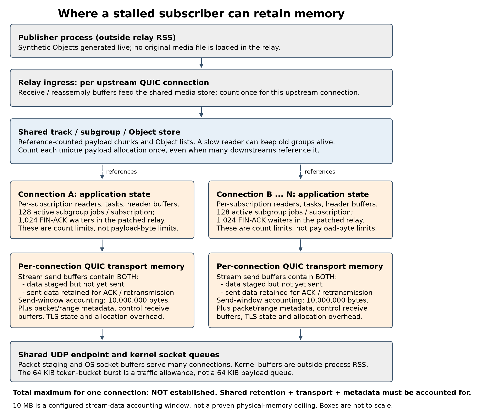

# Memory ownership audit for Progress Report II

This is a source-based model of the tested subgroup-stream path, not a new memory-pressure experiment. The tested relay uses the cumulative recovery patch against Cloudflare moq-rs revision `3b2b584b47e4a18f3a6bf48dc9a665c736743443`, with Quinn-proto 0.11.13. No finite total memory budget per downstream connection has been implemented or established.

## Regions and ownership

- Publisher source: the load generator creates synthetic Objects live. No original media file is loaded into the relay. Publisher and subscriber-generator heaps are outside measured relay RSS, even though they share the host.
- Relay ingress: incoming stream data is buffered and reassembled by the publisher's QUIC connection before entering the shared media store. This is per upstream connection, not a separate copy for every downstream subscriber.
- Shared media: subgroup state owns a vector of Object readers; each Object state owns `Vec<Bytes>` chunks. Readers clone reference-counted state and chunks. A stalled downstream forwarding task can retain a subgroup and all its Object payloads after other readers have finished. The track also retains its latest subgroup. Unique allocations must be counted once, even when several subscribers reference them.
- Downstream application state: each subscription has reader cursors, futures, stream writers, header buffers, and bookkeeping. The tested patched path allows 128 active subgroup jobs and 1,024 FIN-acknowledgment waiters per subscription. A subscription count limit is not a connection-wide payload-byte budget. Completed forwarding jobs release their source readers; FIN waiters retain output/stream state rather than the full source subgroup reader.
- Downstream QUIC: stream send buffers retain application data that may be unsent or sent but not yet reclaimable after acknowledgments. Those are logical states within the same buffer structure, not two independent full payload copies. Packet metadata and retransmission ranges are separate state. The slice-based payload write path copies bytes into transport-owned storage. Control receive buffers, TLS state, allocator capacity, and other protocol metadata also consume memory.
- Endpoint and OS: the relay's public UDP socket serves many connections. Packet staging and kernel socket queues must be distinguished from per-connection payload state. Kernel socket memory is outside process RSS. The shared egress limiter returns WouldBlock when it lacks tokens; its 64 KiB burst is a traffic allowance, not a 64 KiB media queue.

## What is and is not bounded

The relay's native transport configuration leaves Quinn's send-window default unchanged. In Quinn-proto 0.11.13 it is `8 * (12,500,000 bytes/s * 0.1 s) = 10,000,000 bytes`, approximately 9.54 MiB, per QUIC connection. Writes are constrained by remaining peer flow-control credit and the remaining send window.

This limits the transport's unacknowledged stream-data accounting; it is **not a verified cap on physical connection memory**. `SendBuffer` can retain acknowledged ranges behind an earlier gap until a contiguous prefix is reclaimable, and allocation capacity and metadata add overhead. Neither it nor the client's 64 KiB receive window bounds the media kept alive by application readers. The 64 KiB / 32 KiB windows in our runs belong to the subscriber receive side, not a relay application memory budget.

The subgroup store has no configured payload-byte or group-duration cap in this path. Therefore a job-count limit alone cannot supply a workload-independent byte bound. Our three-second forwarding lifetime is also not a total-byte cap; it does not independently bound source Object size, group duration, arrival rate, subscriptions per connection, or all transport allocations. We must not report a maximum such as 1 MB, 10 MB, or 1 GB for the complete connection based on these settings.

## Magnitude and evaluation scale

Our workload produces 499,980 payload bytes per one-second group. If a subscription's 128 active jobs each retain one full group, that set refers to 63,997,440 payload bytes (about 64 MB / 61 MiB), excluding the latest-group reference and all overhead. This is a conditional capacity calculation, not an observed peak or a total-connection bound. Larger or longer-lived groups change the calculation.

A 15-second segment of this source contains about 7.5 MB of payload. Eight subscribers retaining exactly the same segment do not create eight independent 7.5 MB copies in the shared media store. Conversely, independent tracks or disjoint retained groups can add memory. At the default transport window, 100 independently full 10 MB accounting windows represent 1 GB of logical stream data before other regions. That scenario was not reached in our small-window, continuously acknowledging clients. These calculations use decimal MB and GB; measured RSS uses MiB.

In the four-second experiment, median peak relay RSS during recovery was 26.98 MiB for baseline and 23.81 MiB for skip. These are whole-process peaks, not per-connection measurements. They establish neither memory exhaustion nor a guaranteed isolation bound. The accepted experiments primarily establish bandwidth interference and recovery.

The next memory experiment should start with one stalled subscriber plus healthy subscribers. Sweep pause length and group size/duration, then sweep subscriber count and compare shared-track with distinct-track traffic. Measure unique retained application bytes, per-subscription references/jobs, per-connection QUIC accounting, actual allocation/heap retention, and whole-process RSS separately. Add a distinct delayed/lost-ACK condition with adequate receive credit to stress transport retention; an application-reader pause with ongoing ACKs is a different test. Select larger concurrency from the measured incremental memory curve and available node memory, not a presumed number of bytes per subscriber. No instrumentation or experiment described in this paragraph is claimed complete.

## Source anchors

- [Shared subgroup and Object state in pinned upstream](https://github.com/cloudflare/moq-rs/blob/3b2b584b47e4a18f3a6bf48dc9a665c736743443/moq-transport/src/serve/subgroup.rs): `SubgroupsState`, `SubgroupState`, `SubgroupObjectState`, reader cloning and chunk storage.
- [Reference-counted state](https://github.com/cloudflare/moq-rs/blob/3b2b584b47e4a18f3a6bf48dc9a665c736743443/moq-transport/src/watch/state.rs): `State<T>` uses `Arc` ownership.
- [Relay transport configuration](https://github.com/cloudflare/moq-rs/blob/3b2b584b47e4a18f3a6bf48dc9a665c736743443/moq-native-ietf/src/quic.rs): `build_transport_config` retains the default send window.
- [Writer payload and header staging](https://github.com/cloudflare/moq-rs/blob/3b2b584b47e4a18f3a6bf48dc9a665c736743443/moq-transport/src/session/writer.rs): `Writer::encode`, `Writer::write`.
- [Tested cumulative patch](../patches/0002-same-subscription-recovery.patch): forwarding jobs, FIN waiters, expiration, and shared egress limiter. The 1,024-waiter guard is a patched behavior, not a claim about unmodified upstream.
- [Quinn-proto 0.11.13 transport configuration](https://docs.rs/quinn-proto/0.11.13/src/quinn_proto/config/transport.rs.html): `send_window` and `TransportConfig::default`.
- [Quinn-proto send buffer](https://docs.rs/quinn-proto/0.11.13/src/quinn_proto/connection/send_buffer.rs.html): unsent/unacknowledged data, contiguous-prefix reclamation and retained ACK ranges.
- Local locked dependency: `quinn-proto-0.11.13/src/connection/streams/state.rs`, `write_limit` and `received_ack_of`; `streams/send.rs`, `ByteSlice::pop_chunk`.

Regenerate the diagram with `python3 scripts/draw_memory_regions.py` using the optional plotting dependencies.
