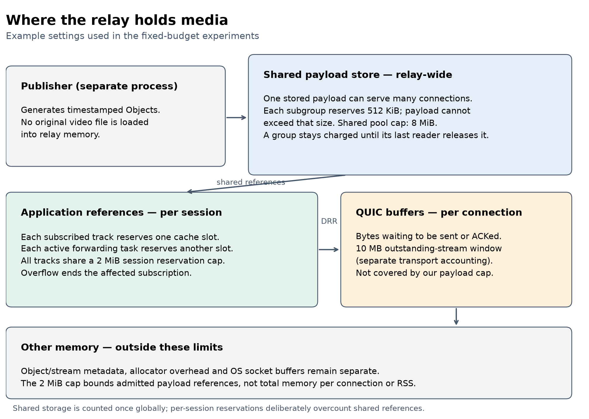
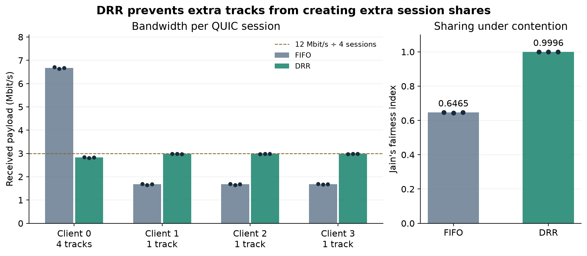
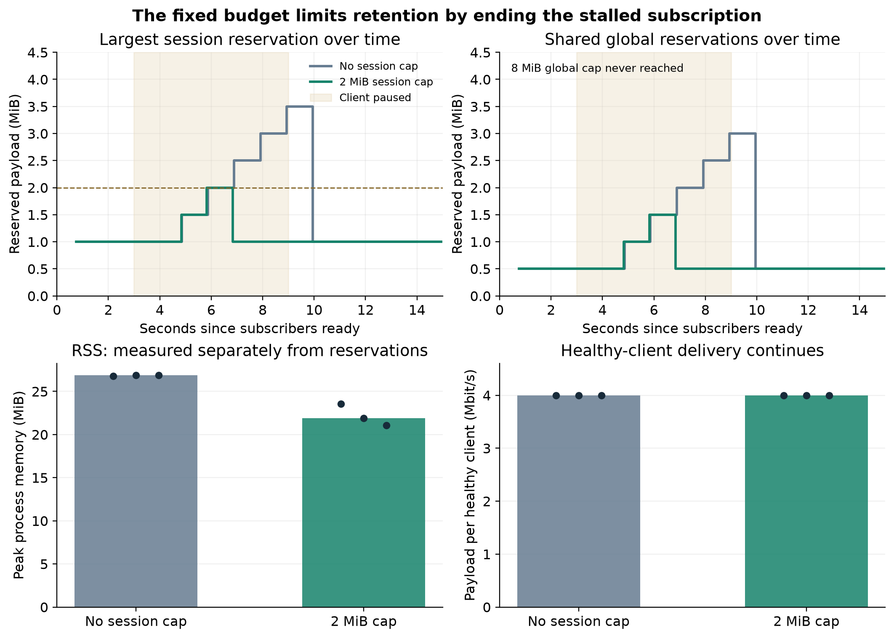

# Resource Isolation in MoQT Relays

Progress Report II - Group 16

Kaustubh Bhal, Shradha Gandotra, Rudra Kanani, Sanat Dhanyamraju, Alan Zhu

November 10, 2026

Our project looks at how a Media over QUIC Transport (MoQT) relay can share bandwidth and memory fairly across subscribers. In Report I, we proposed two main changes: fair bandwidth scheduling across sessions and limits on the media each session can keep buffered. We have now implemented an initial version of both, built a local testbed, and run separate experiments to check what each change accomplishes. This report covers those results and the setup we have prepared for PACE ICE.

## 1. Problem Definition

A MoQT relay receives media from a publisher and forwards it to many subscribers. Each subscriber has its own QUIC connection, but the connections share the relay's memory and outgoing bandwidth. When one subscriber stops keeping up, the relay may retain old media for it. Once that subscriber resumes, sending its backlog can compete with current media being delivered to other clients.

We are mainly focused on the two situations described in Report I. A subscriber requesting many tracks can compete for more bandwidth than a subscriber requesting one. A slow subscriber can keep old media in relay memory after other clients have finished with it. Our goal is to control these costs at the session level, so that adding tracks or falling behind does not give one connection an unrestricted share of the relay's resources.

## 2. Motivation

Live media needs to arrive while it is still useful. A client receiving several seconds of old frames may have high throughput while remaining far behind the live stream. Sending that backlog also uses bandwidth that could carry current media to other subscribers.

At the same time, immediately disconnecting every slow subscriber would be too aggressive, especially when a client only has a short slowdown. We want to share bandwidth fairly and put a clear limit on retained media, while checking what those limits cost in lost delivery and terminated subscriptions. The fixed limits in this report are a first step toward that balance.

## 3. Challenges

Bandwidth and memory are connected. Giving a client less bandwidth can leave more data waiting for it, while sending its backlog faster can take capacity from other clients. We therefore need separate comparisons to understand each mechanism before testing them together.

Shared media also makes memory usage harder to measure. Several subscribers can reference the same Object, so adding their queue sizes would count some payload more than once. We need to distinguish the data a session keeps alive, the shared payload stored by the relay, and data already buffered inside QUIC.

Finally, a slow application reader does not automatically create backpressure at the relay: the client library can keep receiving data into its own buffers. For our memory tests, we pause the client's MoQT session processing and use small receive windows. QUIC still handles packets and acknowledgments, keeping the connection open while the relay's media writes become blocked.

## 4. Methodology

We implemented the two controls from Report I in the same relay. DRR decides which session can hand media bytes to QUIC next. Fixed payload budgets decide how much media a session, and the shared store as a whole, can retain. We evaluate them separately below: first by creating bandwidth contention with a multi-track client, then by making one subscriber stall while the others continue receiving.

### Experimental platform and workload

We built the testbed around Cloudflare's moq-rs relay, pinned at MoQT draft-16 revision 3b2b584. It has three processes: a publisher, the relay, and a generator that opens independent subscriber connections. We began on one machine so we could debug the implementation and repeat experiments before moving to PACE. The local configuration is shown below.

The publisher generates synthetic media Objects, which are the units of data carried by MoQT. Each Object contains a sequence number, a generation timestamp, and a payload the receiver can verify. Each track sends 30 Objects per second at about 4 Mbit/s. Every second starts a new group; in this workload, each group is sent on one QUIC stream, called a subgroup stream. The multi-track workload uses the same source pattern on four tracks.

This continuous one-to-many workload lets us control the source rate and measure both complete delivery and how old the data is when it arrives. A speed test alone would not show whether a client is receiving useful live data or old backlog. Encoded-video replay, including Big Buck Bunny from Report I, remains a later experiment.

| Setting | Local platform and workload |
| --- | --- |
| Hardware | Apple M2 Pro; 10 CPUs; 16 GiB RAM |
| Operating system | macOS 15.3.1, ARM64 |
| Processes | Three processes; four runtime worker threads each |
| Source | 4 Mbit/s per track; 30 Objects/s; one-second groups |
| Subscribers | Four QUIC sessions; one or four tracks per session |
| Receive limits | Bandwidth: 8 MiB/connection, 2 MiB/stream, 64 streams. Memory: 64 KiB/connection, 32 KiB/stream, one stream |
| Bandwidth limit | Application stream bytes: 12 Mbit/s for contention, 64 Mbit/s otherwise; 16 KiB burst |
| Replication | Three repeats per main condition; two per control; shuffled policy order |

### Bandwidth scheduling across sessions

We added a shared application send-rate limit to create repeatable contention. Both comparison policies use this same limit. The baseline serves ready write requests in arrival order (FIFO); DRR instead gives each subscriber session a byte allowance before choosing which of its tracks to serve. This is an instrumented FIFO baseline, not the unchanged upstream relay.

Our DRR scheduler gives each active session 16 KiB of credit per round and attempts writes of at most 8 KiB. All tracks on the same QUIC connection share those credits. Only bytes actually accepted by QUIC are charged. If a write is blocked by flow control, the scheduler can serve another session without spending the blocked session's credits. Within a session, ready streams are ordered by subscriber and publisher priority; existing QUIC stream priorities remain in place.

This gives us a direct test of the bandwidth part of our proposal. Under contention, a client requesting four tracks should receive roughly the same total share as another backlogged client requesting one. The current tests use equal track priorities and Object sizes; we have not yet evaluated mixed priorities or variable-sized media.

### Investigation: How a stalled client affects relay memory

Part of being able to make progress in terms of memory contention was understanding how MoQ handles memory. Our investigation is outlined below.

The relay uses memory in two main ways: storing media that subscribers share, and buffering data for each connection. In our testbed, the publisher generates media as it runs, so the relay does not load an original video file. It receives Objects and stores them so several subscribers can read the same data.

When the relay passes data to QUIC, each subscriber's connection also needs buffers for bytes waiting to be sent or acknowledged. Figure 1 separates these regions and shows where we now enforce limits. A limit on one region does not automatically limit the others. [6]

Figure 1. Memory ownership and the fixed limits used in our tests. Shared payload is stored once globally; per-session reservations track what each session may keep alive. The QUIC and OS regions are outside our new payload budgets.

A stalled client can prevent shared media from being freed even after healthy clients have finished with it. However, that does not mean every stalled client creates another copy. At our 4 Mbit/s source rate, 15 seconds of media contains about 7.5 MB of payload. Eight clients waiting for that same segment can share those bytes; clients waiting for different segments or tracks may retain additional data.

We now limit that retained payload using reservations. Before admitting a subgroup, the relay reserves 512 KiB in the shared pool and rejects payload that would exceed this size. Each session reserves one slot for each track's latest cached group, plus one for every group it is actively forwarding. All of a session's tracks share a 2 MiB budget. The shared pool has a separate 8 MiB budget, counting each subgroup once regardless of how many subscribers use it.

For a single-track session, 2 MiB fits one cache slot and three forwarding slots. If starting another forwarding task would exceed the budget, the relay ends the affected subscription with TOO_FAR_BEHIND and releases its references. This is the fixed-limit eviction proposed in Report I. It is triggered by retained-payload reservations; the earlier timeout experiments are not enabled in these comparisons.

These reservations deliberately overestimate payload use: a partly filled group still consumes a whole slot, and a session can charge the same shared group through more than one reference. That gives us a simple bound to enforce before buffering more data. It does not mean a session physically allocates 2 MiB, or that the relay's total memory stays below 8 MiB.

QUIC remains separate. The tested relay uses a 10 MB outstanding-stream send window per connection, but this accounting excludes other connection state and the shared application media. Our 2 MiB payload bound therefore cannot be added to that window to claim an exact total-memory bound. We measure the relay's resident memory (RSS) separately to check whether controlled retention also reduces the process footprint. [6, 7]

This distinction also affects scale. A 2 MiB payload budget would allow at most 200 MiB of summed session reservations across 100 sessions, or about 1.95 GiB across 1,000; sharing can make physical payload use much smaller, and our 8 MiB global test cap further restricts it. Four local clients are enough to test whether a limit activates correctly. Showing substantial server memory pressure will require more clients or less overlap in the media they retain.

## 5. Related Work

PicNIC: Predictable Virtualized NIC studies how virtual machines sharing a server can interfere with one another's network performance. Its design combines fair queuing, receiver-driven congestion control, and sender-side shaping and accounting. The relevant lesson for us is that controlling bandwidth alone does not isolate every shared resource. We follow that principle by combining scheduling with separate admission budgets. MoQT adds shared media payloads and delivery deadlines, so we account for shared groups separately from each session's references. We do not implement PicNIC's congestion-control system. [1]

Media over QUIC: Initial Testing, Findings and Results provides an early experimental study of MoQ. The authors' companion testbed includes feedback and bandwidth measurements. Our work focuses on resource contention among subscribers sharing one relay. We use synthetic Objects to control the offered load and isolate the scheduling and buffering behavior before introducing video encoding and playback. [2]

Efficient Fair Queuing Using Deficit Round-Robin provides the scheduling algorithm proposed in Report I and now implemented in our relay. DRR gives each backlogged flow a credit measured in bytes and carries unused credit into later rounds. We use subscriber sessions as the flows, with all of a session's tracks sharing one credit balance. Our additional work is integrating this with QUIC write blocking and retained-media budgets. Fair byte allocation alone does not guarantee timely media delivery, which remains part of our evaluation. [3]

## 6. Evaluation Results and Next Steps

### Measurements

We designed the new experiments around the two claims from Report I. For bandwidth, we ask whether DRR stops a multi-track session from taking extra shares under contention. For memory, we ask whether a fixed session budget bounds retained payload while healthy clients continue receiving. Table 1 shows the comparisons. All use the same patched relay and matching client build; we change one policy at a time.

Each run lasts 15 seconds. We measure throughput over seconds 3–15, summing every track on each client's original QUIC connection. Clients that terminate or receive nothing remain in the calculation for the full interval. We record Object latency, payload arriving within 150 ms, current and peak payload reservations, subscription terminations, and the relay's sampled RSS. RSS peaks cover the full run and are sampled about once per second.

We ran three repetitions of each main condition and two of each control, for 20 runs total, shuffling the two policies within each repetition. The publisher maintained approximately 30 Objects/s per track. Unless stated otherwise, the results below are medians across runs. Raw logs, configurations, build hashes, and plotting scripts are saved in the repository.

Table 1. Focused tests of the two implemented controls. Each test uses four subscriber sessions.

| Test | Demand | Client behavior | Compared policies | Runs |
| --- | --- | --- | --- | --- |
| Bandwidth | 28 Mbit/s; 12 Mbit/s cap | One 4-track client; three 1-track clients | FIFO vs. DRR | 3 each |
| Memory | 16 Mbit/s; 64 Mbit/s cap | One of four clients pauses for 6 s | No session cap vs. 2 MiB cap | 3 each |
| Spare bandwidth | 28 Mbit/s; 64 Mbit/s cap | Same mixed track counts | FIFO vs. DRR | 2 each |
| Healthy memory | 16 Mbit/s; 64 Mbit/s cap | All four clients read normally | No session cap vs. 2 MiB cap | 2 each |

### Bandwidth: does requesting more tracks buy a larger share?

One subscriber requests four 4 Mbit/s tracks on the same connection. The other three request one track each, giving 28 Mbit/s of total requested payload. A 12 Mbit/s application cap forces the relay to choose how to divide its bandwidth. Both FIFO and DRR use this same cap, and session/global memory enforcement is disabled in this comparison.

With FIFO, the four-track client received a median 6.68 Mbit/s, while each single-track client received 1.68 Mbit/s. With DRR, the four-track client received 2.83 Mbit/s and the others received about 2.98 Mbit/s each. Jain's fairness index rose from 0.646 to 0.9996, where 1 means equal throughput across sessions. Aggregate received payload stayed similar: 11.71 Mbit/s with FIFO and 11.76 Mbit/s with DRR. Figure 2 shows each repetition.

Figure 2. Per-session payload throughput and fairness under the same 12 Mbit/s application cap. Bars show medians and dots show the three runs. The dashed line is the ideal 3 Mbit/s share before framing overhead and finite-run effects.

This is direct preliminary evidence for our bandwidth scheduler: extra tracks no longer create extra session shares. It is not yet evidence of good live-media delivery under sustained overload. The source demand exceeds the cap, so queues still grow; neither policy delivered payload within our 150 ms target during the measurement window. DRR needs a buffering or stale-media policy alongside it to address that problem. The control with spare bandwidth below checks that the scheduler also lets clients use available capacity when there is no contention.

### Memory: can we limit what a stalled session keeps alive?

For this comparison, all four subscribers request the same 4 Mbit/s track. One pauses after three seconds and resumes six seconds later. We use a 64 Mbit/s application cap, which leaves enough capacity for the healthy clients and later catch-up. Both policies have the same 512 KiB subgroup ceiling and 8 MiB global reservation cap. The only change is whether the 2 MiB session cap is enforced.

Without the session cap, the largest per-session reservation reached 4 MiB in every run. With the cap, it stopped at 2 MiB in every run. Peak global reservations also fell from 3.5 to 2 MiB, showing that releasing the stalled subscription's references allowed old shared groups to be freed in this workload. No run reached the 8 MiB global cap, so this comparison tests session isolation; global rejection is implemented and unit-tested but not exercised here.

The process-memory measurements point in the same direction. Median peak relay RSS fell from 26.86 to 21.91 MiB, about 18%. The three baseline peaks ranged from 26.78 to 26.89 MiB, and the bounded-policy peaks ranged from 21.05 to 23.58 MiB. These are small local runs, and RSS includes more than our payload store, so we treat this as preliminary evidence of lower process memory rather than a general memory bound.

Figure 3. Reservation histories from the first repetition, with the six-second pause shaded. The lower panels show median peak RSS and healthy-client throughput, with all three repetitions marked. Time histories are sampled about once per second; peak values in the text use retained high-water counters. Reservations and RSS are different measurements.

Healthy clients continued receiving about 4.00 Mbit/s each under both policies, with per-client P99 latency between 9.1 and 11.7 ms across the six runs. However, the fixed policy ended the stalled subscription in all three runs. The baseline allowed it to catch up after resuming. The memory improvement therefore has a real cost: the first fixed budget contains retention, but does not yet preserve a temporarily stalled subscriber's delivery.

### Controls and what remains unproven

With a 64 Mbit/s cap, both FIFO and DRR delivered approximately 16 Mbit/s to the four-track client and 4 Mbit/s to each single-track client in both control repetitions. That is the expected result when capacity is available: fairness should not prevent a client from using bandwidth that other clients do not need. In the healthy-only memory control, both policies delivered about 4 Mbit/s per client, and the fixed budget terminated no subscriptions in either repetition.

Our earlier timeout and recovery experiments helped us establish that a client pause reaches the relay and that old forwarding work can be released. Those logs remain in the repository, but the results above evaluate the DRR and byte-budget mechanisms proposed in Report I directly. Timeout-based skipping is disabled here.

The current implementation supports a standalone relay with explicit live subscriptions and subgroup streams. Unsupported delivery paths are rejected when the controls are enabled. We have not yet demonstrated isolation across a relay hierarchy, a total per-connection memory bound, or playback of encoded video. The separate bandwidth and memory comparisons also do not yet establish how the two controls behave together.

### Preparing the PACE ICE experiment

PACE will let us separate the relay's resources from the machines generating its traffic. We have prepared a four-node launcher: one relay, one publisher, and two client generators that split the subscribers evenly. It requests eight CPUs and 32 GiB of memory per node for 30 minutes. These are requested resources; the workers record the actual CPU, RAM, OS, and network configuration when an allocation runs. [4, 5]

The launcher now accepts our patched relay and matching client, checks their hashes against a build manifest, and passes through DRR, memory-budget, and multi-track settings. The analysis combines both generators' logs by subscriber session. The four worker roles passed a local integration check using real QUIC connections, including startup, delivery, logging, and cleanup. That check runs on one machine and does not validate ICE itself.

To run on ICE, we still need to build the Linux binaries in a compute allocation, select the course's account settings if required, and check communication between the allocated nodes. Our guide includes these commands and the matched FIFO/DRR and memory-budget configurations. Before reporting cross-node latency, we will also verify clock offsets; throughput can be analyzed without subtracting timestamps from different machines. No PACE experiment has been run yet.

The first cluster experiment will repeat a short four-client comparison to verify the setup, then increase to 32, 128, and 256 subscribers if the generators can sustain the load. For bandwidth, we will keep demand above the same application cap in both policies and include multi-track sessions. For memory, we will compare 0%, 25%, and 50% stalled clients, including clients retaining different groups or tracks so sharing does not hide the memory cost. We will check generator CPU headroom and source timing before accepting each load level.

### Remaining work

We now have an initial implementation and a direct test of each core mechanism from Report I. DRR improved session fairness under contention, and the fixed session budget bounded retained-payload reservations while healthy clients kept receiving. The remaining work is to test their combination and improve the tradeoff between bounded buffering and useful delivery.

Our next priority is to run these comparisons on PACE and vary the fixed limits, stall durations, and subscriber counts. We will then test DRR together with the session budget, measuring fairness, reservation peaks, RSS, timely delivery, and terminations in the same run. Dynamic limits based on acknowledged delivery rate, live-edge lag thresholds, encoded-video replay, and upstream subscription sharing remain later extensions. We have not implemented those features or included them in the claims above.

References

1. Kumar et al. PicNIC: Predictable Virtualized NIC. SIGCOMM 2019. [Paper.](https://natefoster.org/papers/picnic.pdf)

2. Gurel et al. Media over QUIC: Initial Testing, Findings and Results. MMSys 2023. [DOI](https://doi.org/10.1145/3587819.3593937); [authors' testbed.](https://github.com/streaming-university/public-moq-demo)

3. Shreedhar and Varghese. Efficient Fair Queuing Using Deficit Round-Robin. IEEE/ACM Transactions on Networking, 1996. [Paper.](https://web.stanford.edu/class/ee384x/EE384X/papers/DRR.pdf)

4. Georgia Tech PACE. [ICE job guide](https://gatech.service-now.com/home?id=kb_article_view&sysparm_article=KB0042096) and [storage guide](https://gatech.service-now.com/home?id=kb_article_view&sysparm_article=KB0042094), linked from the [GT teaching tutorial.](https://sites.gatech.edu/higheducation2024/tutorial/)

5. SchedMD. [sbatch](https://slurm.schedmd.com/sbatch.html) and [srun](https://slurm.schedmd.com/srun.html) documentation.

6. [Project memory audit: ownership, source anchors, limits, and scale calculations for the tested relay.](https://github.com/kaustubhbhal/moqt-relay-fairness/blob/codex/local-testbed/docs/memory-isolation-audit.md)

7. [Quinn-proto 0.11.13: transport configuration and send-buffer implementation.](https://docs.rs/quinn-proto/0.11.13/src/quinn_proto/config/transport.rs.html)

[Project repository](https://github.com/kaustubhbhal/moqt-relay-fairness/tree/codex/local-testbed)
