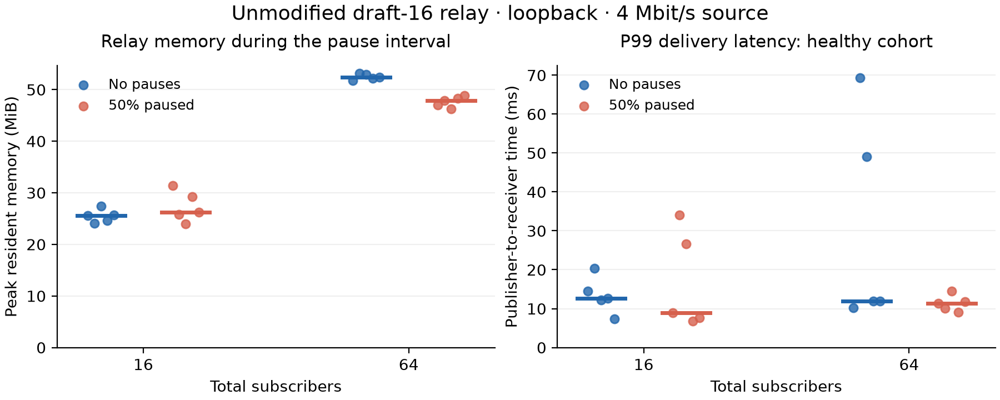
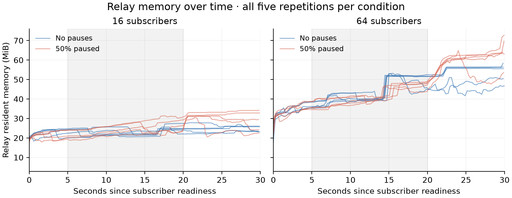
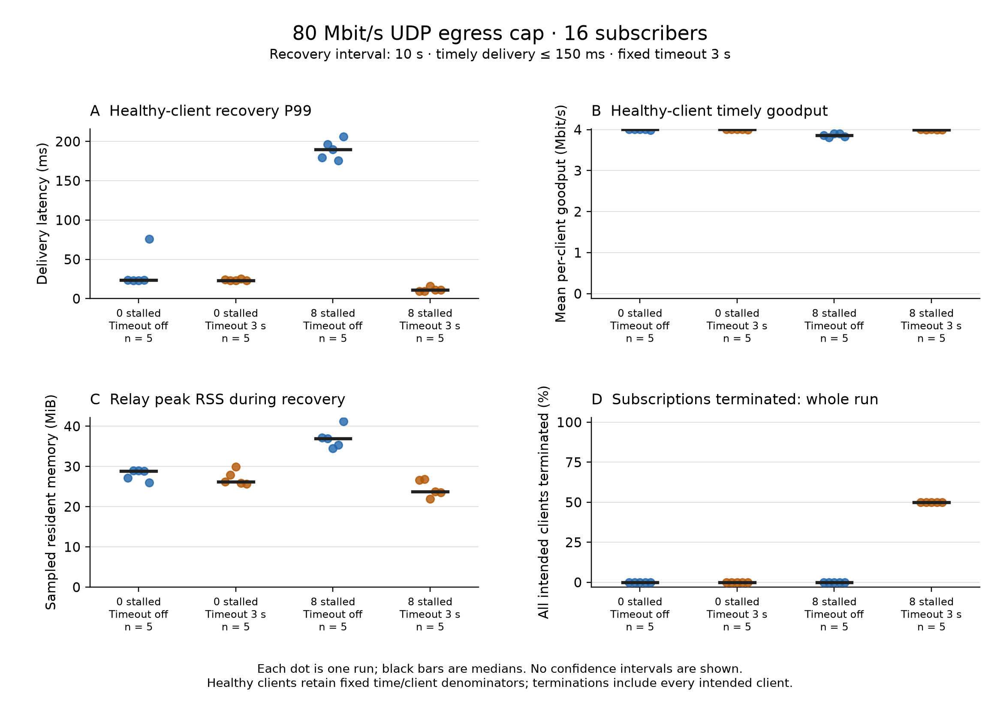

# Progress Report 2 - Group 16

**Resource Isolation and Fair Scheduling in a MoQT Relay**  
Kaustubh Bhal, Shradha Gandotra, Rudra Kanani, Sanat Dhanyamraju, Alan Zhu  
November 10, 2026

## 1. Problem Definition

Our project studies how a Media over QUIC Transport (MoQT) relay should share memory and outgoing bandwidth among subscribers. A subscriber that stops keeping up can leave old media waiting for delivery. We want to limit the resources used by these subscribers while preserving useful service for other clients and keeping the benefits of a shared upstream track.

Since the first report, we have built a working local testbed and completed 20 baseline experiments using the existing relay. We have also implemented a shared outgoing-bandwidth limit and a fixed timeout that ends subscriptions which cannot finish forwarding a subgroup in time. This gives us a first policy to compare against the baseline. The cross-session scheduler and adaptive resource limits are still future work.

## 2. Motivation

For live media, receiving every byte eventually is not enough. Data that arrives several seconds late may no longer be useful. Our first results make this distinction concrete: after a 15-second pause, subscribers received data at roughly 10 Mbit/s even though the source produced only 4 Mbit/s. Much of that traffic was old backlog. This means a relay evaluation needs to measure delivery delay and useful throughput alongside total received bytes.

We also need to separate a slow client's own poor experience from interference with other clients. A useful policy should reduce unnecessary buffering and late delivery without lowering service for subscribers that can keep up.

## 3. Challenges

The first challenge was creating a valid slow-subscriber test. The client library reads QUIC data into its own cache, so slowing only the application's final reader would not necessarily apply backpressure to the relay. Our harness instead pauses MoQT session processing while leaving the QUIC connection alive. We record transport statistics to confirm that media traffic stops growing normally during the pause.

A second issue appeared during recovery. With the library's default incoming-stream allowance, both paused clients in an initial four-client test encountered a cancellation error when overlapping groups arrived. We configured all clients to accept one incoming unidirectional stream at a time, after which the recovery test passed. We did not change the relay or suppress the error. This setting also constrains the workload, so we cannot generalize the results to all client configurations.

Finally, the publisher, relay, and clients currently share one machine. Loopback tests are useful for repeatability and debugging, but they do not reproduce separate client links or prove that relay bandwidth is congested. Process memory also includes transport buffers and runtime overhead, so it cannot be treated as a direct measurement of cached media.

## 4. Methodology and Implementation Progress

We pinned Cloudflare's open-source relay to draft-16 revision `3b2b584` and built it without modifying its source. We added a Rust workload client with publisher and subscriber modes, plus Python scripts to start each experiment, collect measurements, and summarize results. Each subscriber has its own native QUIC connection.

The publisher sends one synthetic track using direct `PUBLISH`. It produces 30 Objects per second, each 16,666 bytes, for an actual target rate of 3.99984 Mbit/s. A new subgroup starts every second. Objects contain a sequence number and generation timestamp, allowing the receiver to check their contents and measure complete-Object delivery time. This exercises shared-track fan-out, but does not yet test upstream `SUBSCRIBE` aggregation.

We chose a paced synthetic workload first because it gives us a known offered load and makes a pause easy to reproduce. It does not include video decoding, keyframe-size bursts, or real network traces. Those remain follow-up workloads rather than completed experiments.

| Setting | Completed local experiment |
| --- | --- |
| Hardware | Apple M2 Pro; 10 reported CPUs; 16 GiB RAM |
| Operating system | macOS 15.3.1, ARM64 |
| Processes | One relay, one publisher, one subscriber generator; four runtime worker threads each |
| Subscribers | 16 or 64 independent sessions |
| Paused subscribers | None or half of the sessions |
| Timing | 30 seconds per subscriber; pause from second 5 to second 20 |
| Receive limits | 64 KiB per connection, 32 KiB per stream, one incoming unidirectional stream |
| Repetitions | Five per condition; condition order shuffled within each repetition |

The harness saves Object logs, QUIC statistics, relay metrics, process memory and CPU samples, commands, configuration, and source revisions. All 20 baseline runs completed with the expected subscribers and no client errors. During the pause interval, the publisher achieved 29.93-30.00 Objects/s. The paused connections received only about 25-34 KB each over 15 seconds while acknowledgements continued, confirming that the test created actual receive backpressure.

For PACE ICE, we have prepared a four-node launcher: one relay node, one publisher node, and two subscriber-generator nodes. It requests eight CPUs and 32 GiB of memory per node for 30 minutes. These are requested resources, not confirmed server specifications. The launcher records the actual machines, waits for each component to become ready, and collects logs before exiting. A local integration test of the four worker roles passed; no ICE experiment has run yet.

The ICE scripts follow the official Slurm launch documentation and link to GT's ICE job and storage guides. Before running there, we still need to confirm our account's allocation limits and shared storage location. We will first build Linux binaries and run a short check on an allocated compute node. Distributed latency results will also require checking clock offsets between machines. The full commands and these open checks are documented in `docs/pace-ice.md`. [4, 5]

## 5. Related Work

**PicNIC: Predictable Virtualized NIC** isolates virtual machines using CPU-fair queues, receiver-driven congestion control, and sender-side shaping and accounting. The main idea relevant to our project is that bandwidth fairness alone does not protect every shared resource. We plan to adapt its accounting and admission-control principles to media sessions, where delayed Objects lose value and subscribers can share stored content. Our current implementation adds shared bandwidth accounting and a fixed forwarding deadline. It is an initial isolation policy, not an implementation of PicNIC's scheduling design. [1]

**Media over QUIC: Initial Testing, Findings and Results** provides an early experimental foundation for MoQ. The authors' companion testbed extends Warp with client-server feedback and active and passive bandwidth measurements. Our work similarly uses a working transport testbed, but focuses on subscribers sharing a relay and the cost of stalled-client recovery. Our current synthetic workload isolates transport behavior; encoded-video tests remain future work. [2]

**Efficient Fair Queuing Using Deficit Round-Robin** provides an efficient way to share transmission service across queues. We still plan to use byte-based DRR as a conventional fairness baseline. Our proposed extension adds buffering and delivery-lag limits, since fair byte allocation alone does not determine whether media arrives while it is useful. Neither DRR nor the adaptive policy is included in the current measurements. [3]

## 6. Evaluation Results and Next Steps

We measure delivery latency from publisher generation to the receiver's complete Object read. We calculate payload goodput for every expected client, including clients receiving no data. We also measure payload goodput for Objects delivered within 150 ms; this is an experimental target, not a protocol requirement. Relay resident memory (RSS) and process CPU are sampled every 250 ms.

For a fair comparison, we use the same upper-half client IDs as the healthy cohort in both conditions. The table below summarizes seconds 5-20. Each entry is the median of five run-level measurements; P99 is calculated separately within each run.

| Total clients | Paused clients | Peak relay RSS (MiB) | Healthy P99 latency (ms) | Healthy goodput (Mbit/s/client) |
| --- | --- | --- | --- | --- |
| 16 | 0 | 25.53 | 12.61 | 4.000 |
| 16 | 8 | 26.28 | 8.95 | 4.000 |
| 64 | 0 | 52.42 | 11.97 | 3.997 |
| 64 | 32 | 47.86 | 11.36 | 4.000 |

*Table 1. Medians over five runs during seconds 5-20. The healthy comparison cohort is fixed across conditions.*

*Figure 1. Each dot is one run; horizontal marks show medians. All five repetitions are shown for each condition.*

We did not observe a consistent reduction in healthy-client throughput during the pause. Memory use also did not consistently increase: at 64 clients, the paused condition used less resident memory during this interval. Tail latency varied across repetitions; for example, healthy-client P99 in the 64-client control ranged from 10.16 to 69.28 ms. We therefore cannot conclude that pausing clients improves latency, or that the relay is isolated under heavier contention. This setup has no imposed outgoing-bandwidth bottleneck.

The recovery period showed a clearer effect. For the previously paused clients, total received throughput was much higher than throughput meeting the 150 ms target:

| Total clients / paused | Received goodput (Mbit/s/client) | Goodput within 150 ms (Mbit/s/client) | P99 delivery latency (s) |
| --- | --- | --- | --- |
| 16 / 8 | 9.98 | 3.82 | 14.76 |
| 64 / 32 | 10.00 | 3.13 | 14.84 |

*Table 2. Medians over five runs, measured during seconds 20-30 for the previously paused cohort.*

At 64 clients, median peak relay RSS during recovery was 64.89 MiB with pauses, versus 55.69 MiB without them. Median relay CPU was about 129% versus 78%, where 100% represents one core. Healthy-client median P99 remained similar, at 15.50 versus 14.78 ms. These uncapped results show extra recovery work and late media delivery, but do not establish sustained harm to other subscribers or identify which buffers caused the memory difference.

*Figure 2. All repetitions are shown. The shaded interval is the pause; previously paused clients resume at second 20.*

We then added an 80 Mbit/s shared outgoing UDP limit and compared the same patched relay with its forwarding timeout disabled or set to three seconds. This limit includes QUIC overhead, control traffic, and retransmissions, with a 64 KiB burst allowance. It is an application-controlled bottleneck, not a physical network link or a fair scheduler. The timeout starts when a downstream forwarder observes a subgroup and includes stream opening, forwarding, and the final acknowledgment. It does not directly measure distance from the live edge or guarantee a memory bound.

We completed another 20 runs: 16 subscribers, none or eight paused, timeout off or on, and five repetitions of each condition. The workload, receive limits, pause interval, and cap were otherwise identical. The timeout ends the subscription with an explicit `TOO_FAR_BEHIND` response. Clients do not reconnect, and we keep terminated clients in the throughput calculation for the full planned interval.

| Paused clients | Timeout | Healthy P99 (ms) | Healthy timely goodput (Mbit/s/client) | Peak relay RSS (MiB) |
| --- | --- | --- | --- | --- |
| 0 | Off | 23.37 | 4.002 | 28.83 |
| 0 | 3 s | 23.28 | 4.003 | 26.17 |
| 8 | Off | 189.62 | 3.860 | 36.92 |
| 8 | 3 s | 10.93 | 4.000 | 23.70 |

*Table 3. Medians of five run-level measurements during recovery, seconds 20-30. Every condition uses the same 80 Mbit/s UDP cap. Timely goodput counts complete Objects delivered within 150 ms.*

Without the timeout, catch-up traffic pushed median outgoing UDP traffic to 79.85 Mbit/s, close to the cap. Healthy-client P99 was 175-206 ms across the five mixed runs, compared with 23-76 ms in the healthy-only control. With the timeout, healthy-client P99 was 10.93 ms at the median, and relay CPU fell from about 58% to 19% of one core. This gives us evidence of interference under a controlled bandwidth limit and shows that stopping stalled subscriptions can reduce it.

The tradeoff is significant: the timeout terminated all eight paused subscriptions in every mixed run, or 40 out of 40 across repetitions. It terminated no healthy subscriptions. The terminated clients received zero goodput during recovery, and their recovery latency is undefined because no Objects arrived. Without the timeout, previously paused clients received a median 5.78 Mbit/s, but none of that recovery traffic met the 150 ms target; their median P99 was 14.94 seconds. The policy therefore protects healthy clients by giving up on stalled subscriptions. It does not yet demonstrate useful recovery or fair service for both groups.

*Figure 3. All five repetitions of each capped condition. The termination panel uses all 16 intended clients, so 50% means all eight paused clients were terminated. Latency and memory refer to the recovery interval.*

We excluded earlier attempts with large timing gaps consistent with host suspension. The runner and analyzer now reject runs whose client observation interval differs from the planned duration by more than 0.5 seconds. The accepted batch used temporary sleep prevention; all 320 client observations lasted 30.000-30.013 seconds. The original 20 baseline runs also passed this check. We preserve the excluded-run diagnostics separately from the accepted measurements.

Our next step is to test shorter pauses and a less aggressive policy that can return clients to current media without ending every stalled subscription. We will then add byte-based DRR and compare it with DRR plus backlog limits under the same cap. Separate-node ICE tests, higher incoming-stream concurrency, and encoded-video replay remain unfinished. We now have a repeatable baseline, an implemented isolation policy, and measurements showing both its benefit and its service cost.

## References

1. Kumar et al. **PicNIC: Predictable Virtualized NIC.** SIGCOMM 2019. [Paper](https://natefoster.org/papers/picnic.pdf).
2. Gurel et al. **Media over QUIC: Initial Testing, Findings and Results.** MMSys 2023. [DOI](https://doi.org/10.1145/3587819.3593937); [authors' testbed](https://github.com/streaming-university/public-moq-demo).
3. Shreedhar and Varghese. **Efficient Fair Queuing Using Deficit Round-Robin.** IEEE/ACM Transactions on Networking, 1996. [Paper](https://web.stanford.edu/class/ee384x/EE384X/papers/DRR.pdf).
4. Georgia Tech PACE. [ICE job guide](https://gatech.service-now.com/home?id=kb_article_view&sysparm_article=KB0042096) and [storage guide](https://gatech.service-now.com/home?id=kb_article_view&sysparm_article=KB0042094), linked from the [GT teaching tutorial](https://sites.gatech.edu/higheducation2024/tutorial/).
5. SchedMD. [sbatch](https://slurm.schedmd.com/sbatch.html) and [srun](https://slurm.schedmd.com/srun.html) documentation.

The original baseline is in `results/preliminary/2026-11-10/`; the capped comparison is in `results/policy/2026-11-10/`. Both include raw measurements, run-level statistics, plots, and reproducibility notes. The implemented relay patch and commands are described in `docs/capped-relay-experiments.md`.
