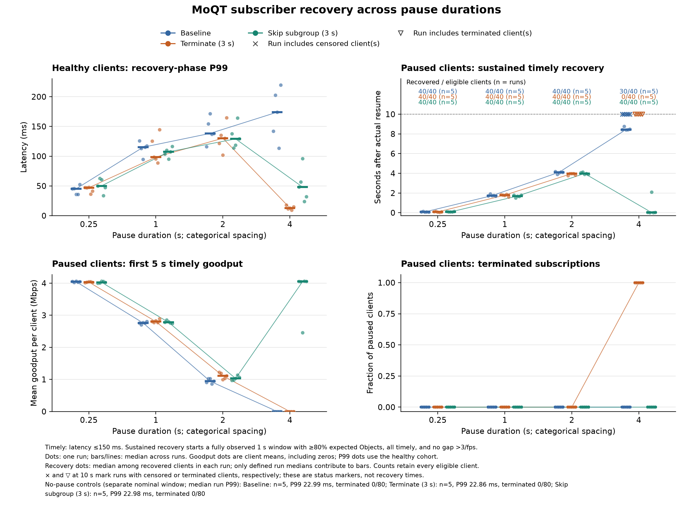

# Progress Report 2 - Group 16

**Resource Isolation and Fair Scheduling in a MoQT Relay**  
Kaustubh Bhal, Shradha Gandotra, Rudra Kanani, Sanat Dhanyamraju, Alan Zhu  
November 10, 2026

## 1. Problem Definition

Our project studies how a Media over QUIC Transport (MoQT) relay should share memory and outgoing bandwidth among subscribers. A subscriber that stops keeping up can leave old media waiting for delivery. We want to stop that backlog from affecting other clients while helping the stalled subscriber return to current media.

We have built a local testbed and implemented two policies: a fixed timeout that ends stalled subscriptions, and a policy that skips stale media streams while keeping the subscription open. We also added a shared bandwidth limit so the comparison includes real contention for a controlled resource. The DRR scheduler and adaptive resource budgets are not implemented yet.

## 2. Motivation

For live media, receiving every byte eventually is not enough. Our uncapped baseline showed paused subscribers receiving about 10 Mbit/s after resuming, even though the source produced only 4 Mbit/s. Much of that traffic was old backlog. When outgoing bandwidth is limited, this catch-up traffic can delay media for healthy clients too.

Closing slow subscriptions protects other clients, but gives up on those subscribers. Our next question is whether dropping stale media can preserve that protection while letting the same subscribers recover.

## 3. Challenges

The first challenge was creating real backpressure. Slowing only the application's reader would let the client library keep buffering data. Our harness instead pauses MoQT session processing while QUIC continues transport processing and acknowledgments. All clients use finite receive windows and one incoming media stream at a time. The single-stream limit avoids an overlapping-group recovery failure observed in the pinned library, but also limits how broadly we can generalize the results.

Skipping a stream introduces another challenge: an intentional reset can interrupt an Object halfway through. We changed the receiver to preserve actual reset codes, so the client can record that loss and continue without accepting corrupt or truncated Objects as successful delivery.

Finally, all processes share one machine. We excluded earlier runs with timing gaps consistent with host suspension and added a duration check. Local tests provide controlled comparisons, but do not reproduce separate client links, video decoding, or a deployed relay.

## 4. Methodology and Implementation Progress

We pinned Cloudflare's relay to draft-16 revision `3b2b584`. The original baseline uses its unchanged source. Our modifications are separate, reproducible patches, and each comparison uses matched relay and client binaries with recorded hashes.

The Rust load generator publishes one synthetic track through direct `PUBLISH`. Each Object contains a sequence number, generation timestamp, and checkable payload. This gives us known offered load and complete-Object latency measurements. The workload exercises shared downstream fan-out; it does not test upstream `SUBSCRIBE` deduplication or encoded-video playback.

| Setting | Local platform and workload |
| --- | --- |
| Hardware | Apple M2 Pro; 10 reported CPUs; 16 GiB RAM |
| Operating system | macOS 15.3.1, ARM64 |
| Processes | One relay, one publisher, one subscriber generator; four runtime worker threads each |
| Source | 30 Objects/s, 16,666 bytes each; approximately 4 Mbit/s; one new group per second |
| Subscribers | Independent QUIC sessions; 16 in policy comparisons, 16 or 64 in the initial baseline |
| Receive limits | 64 KiB per connection, 32 KiB per stream, one incoming unidirectional stream |
| Bandwidth limit | 80 Mbit/s of shared outgoing UDP payload, with a 64 KiB burst allowance |
| Replication | Five runs per condition, with condition order shuffled within each repetition |

Sixteen full-rate subscribers need about 64 Mbit/s of media before overhead. The 80 Mbit/s limit leaves room for normal traffic but makes catch-up traffic compete for a finite budget. It counts QUIC headers, control traffic, and retransmissions, not just useful media. It is an application-controlled bottleneck rather than a physical-link emulator or fair scheduler.

Both policies use a three-second subgroup forwarding limit. Termination ends the subscription with `TOO_FAR_BEHIND`. Skip resets pending media streams for that subscription and waits for a fresh group. The client explicitly permits stale-media dropping and stays on its original connection and subscription. This timer begins when the relay's downstream forwarder observes a subgroup, so it is not a complete implementation of per-Object delivery deadlines or a strict memory limit.

We record complete Object delivery, stream resets, subscription terminations, QUIC counters, relay memory and CPU, commands, and source revisions. Terminated clients remain in throughput denominators through the planned end of the run.

For PACE ICE, we prepared a four-node launcher: one relay, one publisher, and two client-generator nodes, requesting eight CPUs and 32 GiB per node for 30 minutes. These are requested resources, not confirmed server specifications. A local test of the four worker roles passed; no ICE experiment has run. Before testing there, we need to confirm allocation limits and shared storage, build Linux binaries, record the actual hardware, and check clock offsets. The commands are documented in `docs/pace-ice.md`. [4, 5]

## 5. Related Work

**PicNIC: Predictable Virtualized NIC** isolates virtual machines using CPU-fair queues, receiver-driven congestion control, and sender-side shaping and accounting. Its relevant lesson is that bandwidth fairness alone does not protect every shared resource. We apply that question to media sessions, where stale data loses value. Our current work adds accounting and fixed lifetime policies; it does not implement PicNIC's scheduling design. [1]

**Media over QUIC: Initial Testing, Findings and Results** provides an early experimental foundation for MoQ. The authors' companion testbed extends Warp with feedback and bandwidth measurements. Our testbed instead focuses on subscribers sharing a relay and the effect of stalled-client recovery. Encoded-video experiments remain future work. [2]

**Efficient Fair Queuing Using Deficit Round-Robin** provides an efficient way to share transmission service across queues. We plan to implement byte-based DRR as a fairness baseline and compare it with DRR plus stale-media limits. Fair byte allocation and useful live delivery are different questions: a client can receive its share while remaining far behind the source. DRR is not included in the current implementation or results. [3]

## 6. Evaluation Results and Next Steps

We completed 115 accepted local runs across three experiments. Delivery latency runs from publisher generation to a complete Object read. Timely goodput counts payload arriving within 150 ms, our experimental target. Throughput includes every expected client, including clients receiving nothing. Results below are medians of five run-level measurements; they are not pooled across all Objects.

Our first 20 runs used 16 or 64 clients with no outgoing cap. Healthy clients stayed close to the source rate, and we found no consistent healthy-client degradation. Previously paused clients received about 10 Mbit/s during catch-up, but much of that traffic was late. This motivated adding a bandwidth bottleneck rather than claiming the original test already demonstrated unfairness.

The next 20 runs used 16 clients and the 80 Mbit/s cap, with zero or eight clients paused for 15 seconds. A three-second termination timeout reduced healthy-client recovery P99 from 190 to 11 ms and peak relay RSS from 36.92 to 23.70 MiB. However, it terminated all 40 paused subscriptions across the five mixed runs. This protected healthy clients by giving up on the stalled ones.

Our latest experiment tests whether clients can recover without disconnecting. We completed 75 runs: three policies (timeout disabled, terminate, and skip), four pause lengths (0.25, 1, 2, and 4 seconds), and five repetitions, plus five healthy-only controls per policy. Each mixed run has five seconds before the pause and ten seconds after it, with eight of 16 clients paused. Every condition uses the same relay and client builds and the same 80 Mbit/s cap.

To measure return to live, we look for the first complete one-second window after actual resume in which all received Objects meet the 150 ms target, at least 80% of the expected Objects arrive, and no delivery gap exceeds three frame intervals. Recovery time is the start of that window, confirmed using the following second. Clients without such a window before the ten-second observation limit are counted as unrecovered, not silently dropped.

| Pause | Baseline recovered | Baseline recovery time | Skip recovered | Skip recovery time |
| --- | --- | --- | --- | --- |
| 0.25 s | 40/40 | 0.088 s | 40/40 | 0.080 s |
| 1 s | 40/40 | 1.733 s | 40/40 | 1.693 s |
| 2 s | 40/40 | 4.104 s | 40/40 | 3.979 s |
| 4 s | 30/40 | 8.443 s | 40/40 | 0.024 s |

*Table 1. Recovery counts include all eight paused clients in each of five runs. Times are medians of per-run client medians, conditional on recovery; the four-second baseline excludes ten clients that did not recover within the observation window.*

At four seconds, skip recovered all 40 paused clients on their original connections and subscriptions, with no terminations. The relay recorded 40 resynchronizations and clients recorded 40 intentional stream resets. Healthy-client P99 fell from 174 to 48 ms, while healthy timely goodput increased from 3.91 to 4.00 Mbit/s per client. Paused clients' timely goodput during the final five seconds was approximately 4.00 Mbit/s with skip, versus 1.30 Mbit/s with the baseline.

The 24 ms recovery median needs context: skip's five run medians ranged from 5 ms to 2.104 seconds, and the slowest individual client took 2.398 seconds. This is promising preliminary evidence, not a guarantee of near-instant recovery. Termination achieved a lower healthy P99 of 13 ms in this condition, but closed all 40 paused subscriptions and delivered no recovery traffic to them.

*Figure 1. All short-pause repetitions. Recovery counts include every paused client; timing points include only clients that recovered. Markers at ten seconds identify runs with unrecovered or terminated clients, not measured recovery times.*

No policy reset or terminated a subscription during the shorter pauses. All clients recovered, but two-second pauses still required about four seconds of catch-up. The skip policy helps the four-second pause because it crosses the three-second lifetime threshold and abandons old work. It does not automatically help shorter stalls. This is a useful limitation of a fixed threshold and motivates comparing more deliberate scheduling and backlog policies.

All 75 runs passed duration checks, covering 1,200 client observations. Connection and subscription identifiers remained consistent, and no healthy client was terminated. Source delivery during recovery stayed at 29.8-30.1 Objects/s. We retained raw measurements, hashes, and every repetition. Earlier attempts with large timing gaps remain separately marked as excluded.

These experiments use synthetic, independently usable groups on one machine. Real video may need keyframes before playback can resume; resetting a stream is not by itself proof of successful video recovery. We also have not tested higher incoming-stream concurrency, upstream subscription sharing, or separate-node network conditions. The timer is a fixed forwarding lifetime, not an adaptive buffer budget.

Our next implementation step is byte-based DRR across subscriber sessions, followed by a comparison of DRR alone and DRR plus stale-media skipping under the same cap. We will then test encoded media and longer, uneven client workloads, and move the experiment to PACE ICE once its allocation is confirmed. The current results demonstrate contention, the cost of terminating stalled subscriptions, and a working way to recover them without disconnecting; they do not yet demonstrate fair scheduling.

## References

1. Kumar et al. **PicNIC: Predictable Virtualized NIC.** SIGCOMM 2019. [Paper](https://natefoster.org/papers/picnic.pdf).
2. Gurel et al. **Media over QUIC: Initial Testing, Findings and Results.** MMSys 2023. [DOI](https://doi.org/10.1145/3587819.3593937); [authors' testbed](https://github.com/streaming-university/public-moq-demo).
3. Shreedhar and Varghese. **Efficient Fair Queuing Using Deficit Round-Robin.** IEEE/ACM Transactions on Networking, 1996. [Paper](https://web.stanford.edu/class/ee384x/EE384X/papers/DRR.pdf).
4. Georgia Tech PACE. [ICE job guide](https://gatech.service-now.com/home?id=kb_article_view&sysparm_article=KB0042096) and [storage guide](https://gatech.service-now.com/home?id=kb_article_view&sysparm_article=KB0042094), linked from the [GT teaching tutorial](https://sites.gatech.edu/higheducation2024/tutorial/).
5. SchedMD. [sbatch](https://slurm.schedmd.com/sbatch.html) and [srun](https://slurm.schedmd.com/srun.html) documentation.

The accepted datasets are in `results/preliminary/2026-11-10/`, `results/policy/2026-11-10/`, and `results/recovery/2026-11-10/`. Each includes raw measurements and reproduction instructions. Implementation details are in `docs/capped-relay-experiments.md` and `docs/live-recovery-experiments.md`.
