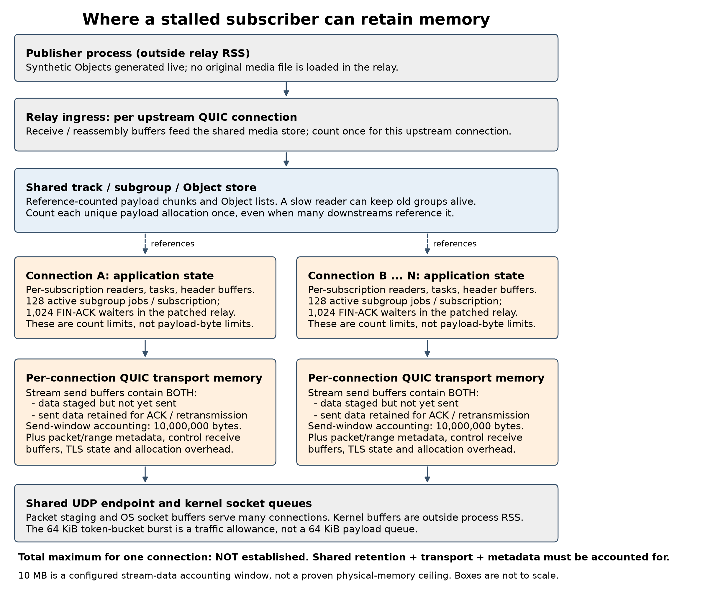

# Resource Isolation in MoQT Relays

Progress Report II - Group 16

Kaustubh Bhal, Shradha Gandotra, Rudra Kanani, Sanat Dhanyamraju, Alan Zhu

November 10, 2026

Our project looks at how a Media over QUIC Transport (MoQT) relay can share bandwidth and memory fairly across subscribers. Since Report I, we have built a local testbed, tested how stalled clients affect other subscribers, and implemented a way for them to return to current media without disconnecting. This report covers those results and our preparation for the first experiment on PACE ICE.

## 1. Problem Definition

A MoQT relay receives media from a publisher and forwards it to many subscribers. Each subscriber has its own QUIC connection, but the connections share the relay's memory and outgoing bandwidth. When one subscriber stops keeping up, the relay may retain old media for it. Once that subscriber resumes, sending its backlog can compete with current media being delivered to other clients.

Report I proposed both fair bandwidth scheduling and limits on buffered media. We started with stalled subscribers because they give us a controlled way to study this interaction. Our immediate question was whether the relay could protect healthy clients while still allowing stalled clients to recover.

## 2. Motivation

Live media needs to arrive while it is still useful. A client receiving several seconds of old frames may have high throughput while remaining far behind the live stream. Sending that backlog also uses bandwidth that could carry current media to other subscribers.

Disconnecting every slow client would avoid some of this work, but would also interrupt clients experiencing temporary slowdowns. We therefore want to distinguish between ending a subscription and dropping media that is already too old to be useful. Our experiments compare those choices.

## 3. Challenges

The first challenge was making a client stall affect the relay. If we only slowed the final application reader, the client library could continue receiving and buffering data. We instead pause the client's MoQT session processing and use small receive buffers. As those buffers fill, the relay can no longer keep writing to that client. QUIC still processes packets and acknowledgments, so the connection remains open.

The second challenge was separating shared memory from memory used by individual connections. Several subscribers can reference the same media, so adding their queue sizes would count some payloads more than once. We traced the storage path to understand which data a stalled client can keep alive; the memory model is described below.

Finally, dropping old media must not make an incomplete Object look like a successful delivery. We changed the receiver to recognize intentional stream resets and continue reading later groups, while still treating malformed or truncated data as errors.

## 4. Methodology

### Experimental platform and workload

We built the testbed around Cloudflare's moq-rs relay, pinned at MoQT draft-16 revision 3b2b584. It has three processes: a publisher, the relay, and a generator that opens independent subscriber connections. We began on one machine so we could debug the implementation and repeat experiments before moving to PACE. The local configuration is shown below.

The publisher generates synthetic media Objects, which are the units of data carried by MoQT. Each Object contains a sequence number, a generation timestamp, and a payload the receiver can verify. We send 30 Objects per second at about 4 Mbit/s. Every second starts a new group; in this workload, each group is sent on one QUIC stream, called a subgroup stream.

This continuous one-to-many workload lets us control the source rate and measure both complete delivery and how old the data is when it arrives. A speed test alone would not show whether a client is receiving useful live data or old backlog. Encoded-video replay, including Big Buck Bunny from Report I, remains a later experiment.

| **Setting** | **Local platform and workload** |
| --- | --- |
| Hardware | Apple M2 Pro; 10 CPUs; 16 GiB RAM |
| Operating system | macOS 15.3.1, ARM64 |
| Processes | One relay, one publisher, one subscriber generator; four runtime worker threads each |
| Source | 30 Objects/s, 16,666 bytes each; approximately 4 Mbit/s; one new group per second |
| Subscribers | Independent QUIC sessions; 16 in policy comparisons, 16 or 64 in the initial baseline |
| Receive limits | 64 KiB per connection, 32 KiB per stream, one incoming unidirectional stream |
| Bandwidth limit | 80 Mbit/s of shared outgoing UDP payload, with a 64 KiB burst allowance |
| Replication | Five runs per condition, with condition order shuffled within each repetition |

### Relay modifications

We first ran the unchanged relay, then added a shared 80 Mbit/s outgoing UDP limit. Sixteen subscribers need about 64 Mbit/s of media before overhead, so normal delivery fits within the limit, while catch-up traffic can create contention. The limit includes QUIC headers, control traffic, and retransmissions. It creates a controlled bandwidth bottleneck; it doesn’t decide which connection gets a fair share.

We implemented two ways to handle old work. The ‘terminate’ policy ends a subscription if forwarding one of its subgroups takes more than three seconds. The ‘skip’ policy uses the same threshold but resets the subscription's pending media streams and waits for a fresh group. The client permits this dropping and continues on its original connection and subscription.

The timer starts when the relay's downstream forwarder observes the subgroup and includes waiting to open a stream, sending data, and waiting for the final acknowledgment. It therefore limits how long forwarding work remains active, rather than directly measuring the client's distance from the live stream. Note: It’s not a per-connection memory cap.

We tested these changes with real QUIC connections, including expiry during stream opening, resets halfway through an Object, and delivery of a fresh group afterward. The Rust and client tests passed, as did 18 Python tests for the experiment and analysis tools. We also kept raw logs, source and binary hashes, and the commands needed to reproduce each accepted run.

### How a stalled client affects relay memory

The relay uses memory in two main ways: storing media that subscribers share, and buffering data for each connection. In our testbed, the publisher generates media as it runs, so the relay does not load an original video file. It receives the Objects and stores them so several subscribers can read the same data.

When the relay passes data to QUIC, each subscriber's connection also needs buffers for bytes waiting to be sent or acknowledged. Figure 1 shows these regions separately because a limit on one does not necessarily limit the others. [6]

Figure 1. Where media is stored and which regions are shared. The numbers label configuration limits; they are not measurements of the maximum memory one connection consumes.

A stalled client can prevent shared media from being freed even after healthy clients have finished with it. However, that does not mean every stalled client creates another copy. At our 4 Mbit/s source rate, 15 seconds of media contains about 7.5 MB of payload. If eight clients are waiting for the same segment, the shared store holds that payload once. Clients waiting for different segments or different tracks can keep additional data in memory.

The amount one subscription can keep alive depends on the size of its groups. Our patched relay allows 128 active forwarding tasks per subscription. If each task holds one full group from our one-second-group workload, those groups contain about 64 MB of payload. This is an estimate for that specific situation, not an observed peak or a maximum for the whole connection. Larger groups would change the estimate. [6]

QUIC has a separate limit: the tested relay uses a 10 MB send window per connection. That limits its accounting of outstanding stream data, but it does not include the shared media described above or all of the connection's other memory. We therefore cannot say that a connection uses at most 10 MB. We have not yet established a total per-connection memory bound, and our three-second timeout does not provide one. [6, 7]

This is why the memory experiment needs a different scale check from the bandwidth experiment. We will first measure how much extra memory one stalled client keeps alive, then add clients that share a track and clients that receive different tracks. Those measurements will tell us how many connections are needed to create significant memory pressure. The current whole-process memory results appear in the evaluation section.

## 5. Related Work

PicNIC: Predictable Virtualized NIC studies how virtual machines sharing a server can interfere with one another's network performance. Its design combines fair queuing, receiver-driven congestion control, and sender-side shaping and accounting. The relevant lesson for our project is that controlling bandwidth alone does not isolate every shared resource. MoQT adds two complications: old media loses value, and several subscribers may share the same payload. Our current work examines those complications through stale-media handling and memory ownership; it does not implement PicNIC's scheduler. [1]

Media over QUIC: Initial Testing, Findings and Results provides an early experimental study of MoQ. The authors' companion testbed includes feedback and bandwidth measurements. Our work focuses on a different part of the delivery path: what happens when subscribers sharing one relay stall and then catch up. We use synthetic Objects to isolate that behavior before introducing video encoding and playback. [2]

Efficient Fair Queuing Using Deficit Round-Robin provides the scheduling baseline proposed in Report I. DRR gives each backlogged flow a credit measured in bytes and carries unused credit into later rounds. We plan to use subscriber sessions as the flows. However, receiving a fair share of bytes does not necessarily bring a client back to live media, so we will compare DRR alone with DRR plus stale-media skipping. DRR has not yet been implemented. [3]

## 6. Evaluation Results and Next Steps

### Measurements

We completed 115 local runs across three experiments. Each condition has five repetitions, with the order shuffled within each repetition. Unless stated otherwise, comparisons use medians of five run-level measurements. We measure latency from Object generation to a complete receiver read. P99 is the latency at or below which 99% of received Objects arrive. We also measure timely goodput: payload delivered within 150 ms, our chosen live-delivery target. Clients that receive nothing or terminate remain in the throughput calculation.

For return to live experiments, we require a full one-second window after resume in which every received Object meets the 150 ms target, at least 80% of expected Objects arrive, and no delivery gap exceeds three frame intervals. Recovery time is the start of that window, verified using the following second. We report recovery counts alongside times so clients that do not recover within the ten-second observation period remain visible.

### From baseline behavior to recovery without disconnecting

Our first 20 runs tested the unchanged relay with 16 or 64 clients and no outgoing bandwidth cap. Healthy clients stayed close to the source rate, and we did not find any consistent degradation. Previously paused clients received about 10 Mbit/s while catching up with a 4 Mbit/s source, showing that much of their traffic was backlogged. This gave us a reason to test recovery when bandwidth was limited.

The next 20 runs used the 80 Mbit/s cap with 16 clients, either none or eight paused for 15 seconds. With the three-second termination policy, healthy-client recovery P99 fell from 190 to 11 ms, and peak relay RSS fell from 36.92 to 23.70 MiB. However, 40 paused subscriptions across the five mixed runs were terminated. Ending them protected healthy clients but did not let the stalled clients recover.

We then tested the skip policy to see whether we could preserve the benefit while keeping those subscriptions open. This experiment had 75 runs: three policies (timeout disabled, terminate, and skip), four pause lengths (0.25, 1, 2, and 4 seconds), and five repetitions, plus five healthy-only controls per policy. Mixed runs paused eight of 16 clients after five seconds and observed them for ten seconds after resume. All conditions used the same relay and client builds and the same bandwidth cap.

| **Pause** | **Baseline recovered** | **Baseline recovery time** | **Skip recovered** | **Skip recovery time** |
| --- | --- | --- | --- | --- |
| 0.25 s | 40/40 | 0.088 s | 40/40 | 0.080 s |
| 1 s | 40/40 | 1.733 s | 40/40 | 1.693 s |
| 2 s | 40/40 | 4.104 s | 40/40 | 3.979 s |
| 4 s | 30/40 | 8.443 s | 40/40 | 0.024 s |

Table 1. Recovery across five runs, with eight paused clients per run. Times are medians of per-run client medians, conditional on recovery. The four-second baseline time excludes ten clients that did not recover within the observation period.

The clearest benefit appeared with four-second pauses. Skip recovered all 40 stalled clients on their original connections and subscriptions, compared with 30 of 40 for the baseline. It reduced healthy-client P99 from 174 to 48 ms and increased healthy timely goodput from 3.91 to 4.00 Mbit/s per client. During the final five seconds, previously paused clients also received about 4.00 Mbit/s of timely data with skip, compared with 1.30 Mbit/s for the baseline.

Recovery time varied despite the low 24 ms median in the table. Skip's five run medians ranged from 5 ms to 2.104 seconds, and the slowest individual client took 2.398 seconds. The terminate policy reduced healthy-client P99 further, to 13 ms, but ended all 40 paused subscriptions. No healthy client was terminated in this experiment.

Figure 2. Individual runs and medians across pause lengths. Recovery counts include every paused client; recovery-time points include only clients that recovered. Markers at ten seconds identify runs with unrecovered or terminated clients, not measured recovery times.

Shorter pauses explain the limitation of our current policy. Neither timeout policy activated during pauses of 0.25, 1, or 2 seconds. All clients recovered, but a two-second pause still led to about four seconds of catch-up. The four-second pause crossed the three-second forwarding threshold, allowing skip to discard the old work. A fixed threshold can therefore help a longer stall while leaving a shorter one largely unchanged.

Memory results were less conclusive. In the four-second condition, median peak relay RSS during recovery was 26.98 MiB for the baseline and 23.81 MiB for skip. These whole-process measurements do not establish a per-connection maximum or show memory exhaustion. Our strongest result so far is that stale-media skipping can reduce bandwidth interference while allowing stalled clients to recover.

### What the local results cover

All 75 short-pause runs passed duration checks, covering 1,200 client observations, and source production during recovery stayed at 29.8-30.1 Objects/s. Earlier attempts with large timing gaps were excluded and retained separately. We verified connection and subscription identifiers to check that recovery did not rely on reconnecting.

The tests still have limits. All processes ran on one machine, and clients allowed only one incoming media stream at a time to avoid an overlapping-group recovery failure in the pinned library. The synthetic groups are independently usable; real video may need a keyframe before playback can resume. We have not yet tested encoded video, upstream subscription deduplication, or subscribers requesting multiple tracks.

### Moving the experiment to PACE ICE

The next experimental step is to separate the relay, publisher, and client generators across PACE ICE nodes. We have prepared a four-node launcher: one relay, one publisher, and two generators that split the clients evenly. It requests eight CPUs and 32 GiB per node for 30 minutes. These are requested resources, not confirmed server specifications; the workers record the actual hardware, operating system, interfaces, and routes. [4, 5]

The launcher handles certificates, waits for the relay and publisher to be ready, starts the clients, saves logs, and cleans up if a worker fails. A local test of all four worker roles passed using real QUIC connections. Before the first PACE submission, we still need to confirm allocation and shared-storage access, build Linux binaries, and check communication and clock offsets between nodes. The build and submission commands are in the linked [PACE guide](https://github.com/kaustubhbhal/moqt-relay-fairness/blob/codex/local-testbed/docs/pace-ice.md). [4]

We will first run a 20-second check with 16 clients, no pauses, and the stock relay. Success requires all workers and clients to complete, valid delivered payloads, the intended source rate, and enough generator CPU headroom. Once that passes, we will compare zero versus eight paused clients over 19 seconds: five seconds before a four-second pause and ten seconds afterward, with five repetitions per condition. The current placement puts the eight stalled clients on one generator, so we will hold placement fixed and check its effect before scaling. Cross-node latency measurements also require checking clock-offset uncertainty.

The prepared ICE launcher currently supports the stock-relay baseline. Running the modified policies there still requires selecting the patched Linux binaries, passing the cap and policy settings, recording their hashes, and adapting analysis to both generator logs. No PACE experiment has been run; this report ends at preparation for that first baseline experiment.

### Remaining implementation and evaluation

The next implementation step is byte-based DRR, followed by a comparison of DRR alone and DRR plus skipping under the same cap. We will measure fairness alongside timely delivery and recovery. Per-session byte budgets and a global application-memory cap from Report I also remain unfinished.

For memory, we will start with one stalled subscriber plus healthy clients, vary pause length and group size, and compare shared-track with distinct-track traffic. We will measure retained payloads, transport allocations, and RSS separately, with a separate delayed/lost-ACK condition for transport buffering. Those measurements will determine the client count needed for a larger memory-pressure experiment on PACE.

## References

1. Kumar et al. **PicNIC: Predictable Virtualized NIC.** SIGCOMM 2019. [Paper.](https://natefoster.org/papers/picnic.pdf)

2. Gurel et al. **Media over QUIC: Initial Testing, Findings and Results.** MMSys 2023. [DOI](https://doi.org/10.1145/3587819.3593937); [authors' testbed.](https://github.com/streaming-university/public-moq-demo)

3. Shreedhar and Varghese. **Efficient Fair Queuing Using Deficit Round-Robin.** IEEE/ACM Transactions on Networking, 1996. [Paper.](https://web.stanford.edu/class/ee384x/EE384X/papers/DRR.pdf)

4. Georgia Tech PACE. [ICE job guide](https://gatech.service-now.com/home?id=kb_article_view&sysparm_article=KB0042096) and [storage guide](https://gatech.service-now.com/home?id=kb_article_view&sysparm_article=KB0042094), linked from the [GT teaching tutorial.](https://sites.gatech.edu/higheducation2024/tutorial/)

5. SchedMD. [sbatch](https://slurm.schedmd.com/sbatch.html) and [srun](https://slurm.schedmd.com/srun.html) documentation.

6. [Project memory audit: ownership, source anchors, limits, and scale calculations for the tested relay.](https://github.com/kaustubhbhal/moqt-relay-fairness/blob/codex/local-testbed/docs/memory-isolation-audit.md)

7. [Quinn-proto 0.11.13: transport configuration and send-buffer implementation.](https://docs.rs/quinn-proto/0.11.13/src/quinn_proto/config/transport.rs.html)

[Project repository](https://github.com/kaustubhbhal/moqt-relay-fairness/tree/codex/local-testbed)
